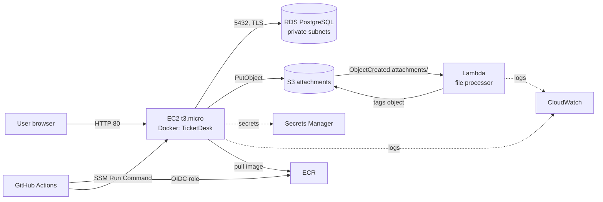

# TicketDesk – AWS Deployment POC

A lightweight IT support ticket tracker (Python / FastAPI) deployed on AWS with Terraform and GitHub Actions.

Repository: https://github.com/prathamxd/aws-poc

## Team

| Member | Role | Owns |
|--------|------|------|
| Pratham Kumar Luker | Platform & DevOps | Terraform root + `network`, `compute`, `cicd` modules · EC2 / ECR / Docker · GitHub Actions · web UI (`app/main.py`, templates) |
| Arjit Sharma | Data & Serverless | `database`, `storage`, `lambda` modules · RDS, S3, Lambda · data layer (`app/database.py`, `models.py`, `storage.py`) · local PostgreSQL |
| Shaan Saxena | Security, Monitoring & QA | `secrets`, `monitoring` modules · app configuration and security (`config.py`, `security.py`, `workflow.py`) · test suite, smoke test, security verification |



## Features

| Feature | Details |
|---------|---------|
| Login / register | Session cookie, PBKDF2-hashed passwords |
| Roles | `user` raises and sees own tickets · `agent` sees all and changes status · `admin` also manages roles |
| Tickets | Create, list, filter, search, detail page with history |
| Status workflow | Open → In Progress → Resolved → Closed (Resolved can be re-opened) |
| Dashboard | Counts by status and priority, recently updated tickets |
| Attachments | Stored in S3, validated, processed by Lambda (status shown per file), downloaded via presigned URL |
| Ops | `/health` (DB check + version), JSON API under `/api`, CloudWatch logs |

## Repository layout

```
app/                     FastAPI application (routes, models, config, storage, templates)
tests/                   pytest suite (app, workflow, security, Lambda)
lambda/file_processor/   S3-triggered Lambda
terraform/               Root module + modules/{network,database,storage,secrets,lambda,compute,cicd,monitoring}
.github/workflows/       ci.yml (tests, terraform validate, gitleaks, checkov, docker) · deploy.yml (OIDC → ECR → SSM)
scripts/                 deploy.py · smoke_test.py · verify_security.py
db/schema.sql            PostgreSQL schema
docs/TEST_CASES.md       Manual test cases;  docs/evidence/ = generated test reports
Dockerfile, docker-compose.yml
```

## Run locally

```bash
python -m venv .venv
source .venv/bin/activate            # Windows: .venv\Scripts\Activate.ps1
pip install -r requirements-dev.txt
cp .env.example .env                 # Windows: copy .env.example .env  -> then edit the passwords
pytest --cov=app                     # 37 tests
uvicorn app.main:app --reload        # http://localhost:8000 (SQLite)
docker compose up --build            # same app with PostgreSQL 16
```

## Deploy to AWS

```bash
cd terraform
cp terraform.tfvars.example terraform.tfvars   # set owner, github_repository, alert_email
terraform init && terraform validate
terraform apply
terraform output github_actions_variables      # add as GitHub repository *variables*
```

Then run **Actions → Deploy to AWS** (or `python scripts/deploy.py` from the repo root).
Admin password: run the command printed by `terraform output -raw admin_password_command`.

Verify:

```bash
python scripts/smoke_test.py        # 16 end-to-end checks against AWS
python scripts/verify_security.py   # security pass/fail checks
```

Tear down: `terraform destroy`.

## Security summary

- No secrets in the repository: `.env`, Terraform state and tfvars are git-ignored; gitleaks runs in CI.
- App secrets (session key, admin password) and the RDS password (managed by RDS) live in AWS Secrets Manager and are read at runtime through the EC2 instance role.
- GitHub Actions authenticates with OIDC – no AWS access keys stored in GitHub; the role trusts only this repo's `main` branch.
- RDS: private subnets, not publicly accessible, security group allows 5432 only from the app security group, storage encrypted, TLS enforced.
- EC2: no SSH key or port 22 (Session Manager instead), IMDSv2 required, encrypted volume, egress limited to 443 and 5432.
- S3: Block Public Access, default encryption, versioning, HTTPS-only bucket policy.
- IAM: one least-privilege role each for EC2, Lambda and the pipeline, scoped to specific ARNs.
